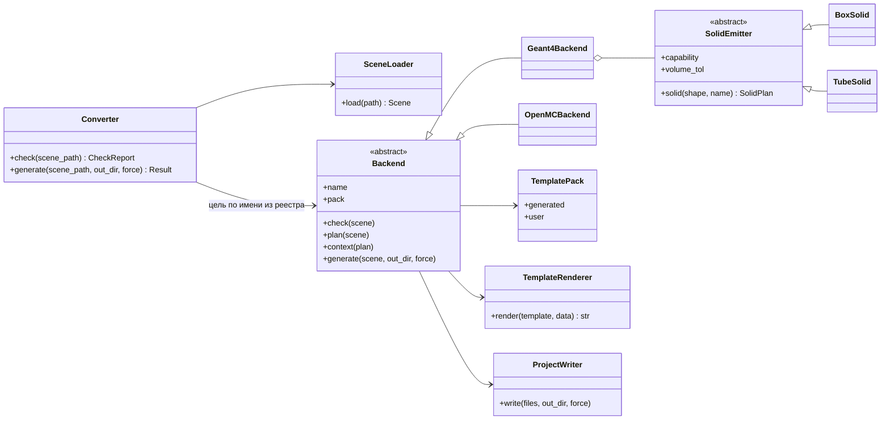
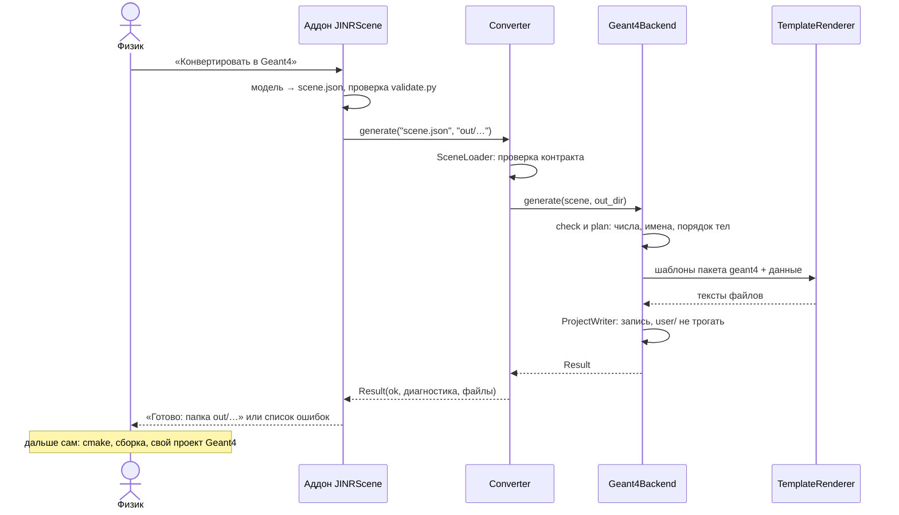

# Пошаговый план выходного модуля, версия 3

*Ваня • 15 октября 2026 • после встречи 14.10; заменяет версию от 11.10*

Это рабочая инструкция: что делать по порядку, как проверять и когда этап считается законченным. Архитектура и обоснования — в «Плане выходного модуля v2» и в `docs/decisions/`. Если что-то в них расходится с этим файлом, верно то, что здесь.

> Код в этом файле — наброски для ориентира. Проверены на прототипе только шаблоны Jinja2 из этапа 2 (см. решение 001).

---

## 1. Что изменилось после встречи 14.10

| Вопрос | Было (план от 11.10) | Стало | Почему |
|---|---|---|---|
| Как печатается код | `string.Template` для каркаса, тела склеиваются строками в `printer.py` | **все файлы из шаблонов Jinja2**, своя папка шаблонов на каждую программу ([решение 001](decisions/001-template-engine.md)) | руководитель: генерация через шаблоны, «пакет диалекта» на Geant4, FLUKA, MCNP |
| Устройство кода | модули с отдельными функциями (`build_plan`, `render`, `write_project`…) | **классы**: цель (`Backend`), реестр целей, `Converter` как вход для аддона и CLI, фигуры — классы | руководитель: уходить от скриптов к объектам и паттернам, пока программа маленькая |
| Связь с аддоном | аддон запускает `mcscene` отдельным процессом | основной вариант — **аддон импортирует `mcscene` в своём Python (3.11)**; CLI остаётся для терминала и тестов. Окончательно решаем на встрече после ответа Никиты про зависимости | руководитель: один интерпретатор лучше, чем два процесса |
| Зависимости | pydantic и jsonschema (у обоих внутри скомпилированные части) | во время работы — **только Jinja2** (чистый Python); jsonschema — только в тестах; pydantic заменяем своими классами, если выберут один интерпретатор | чтобы конвертер можно было положить в аддон папкой |
| Главный результат MVP | окно Geant4 по кнопке, демо с частицами | **читаемый C++, который физик кладёт в свой проект Geant4, собирает и запускает сам**; профиль `library` важнее своего приложения | руководитель: пока достаточно кода, который человек посмотрит, положит в проект Geant4, соберёт и запустит сам |
| GDML | не делаем | не делаем — подтверждено | в отделе им не пользуются; у FLUKA и MCNP свои форматы |
| Репозиторий | свой `jinr-converter` | **репозиторий руководителя**: две папки (аддон и конвертер), пути только относительные, без бинарников | руководитель |
| Документация | план и `setup.md` | плюс описание того, что уже есть: архитектура, кодогенерация, формат `scene.json` — в Markdown в том же репозитории | руководитель |
| Номера этапов | 0–6 | добавлен **этап 2 «Шаблоны и объекты»**, старые этапы 2–6 стали 3–7 | этапы 0–1 сделаны на две недели раньше срока, этап 2 занимает освободившееся время |

Даты этапов 3–6 не сдвинулись: этап 2 помещается в недели, которые остались от этапа 1.

## 2. Сводка

| Этап | Даты | Готово, когда | Образец от Никиты |
|---|---|---|---|
| 0. Каркас | ✅ 12–13 окт | `mcscene validate` даёт тот же вердикт, что `validate.py` | куб 50 мм |
| 1. Сквозная коробка | ✅ 13–14 окт | куб и коробка Никиты из FreeCAD видны в Geant4, стенд = 0 | куб, коробка 20×40×70 (настоящие экспорты) |
| **2. Шаблоны и объекты** | **15 окт – 1 ноя** (ядро — к следующей встрече) | весь код печатается из шаблонов Jinja2, код разложен по классам, у аддона есть вход `Converter`; сгенерированный C++ не изменился | ответ про зависимости во FreeCAD |
| 3. Примитивы и повороты | 2–15 ноя | цилиндр, сфера, конус, тор, вложенность, ловушка поворотов | повёрнутая коробка, цилиндр, труба с вакуумом, сфера |
| 4. Материалы и булевы | 16–29 ноя | Cut из FreeCAD в Geant4, свои составы | `Part::Cut`; два тела с назначенными материалами |
| 5. Меши и отчёт | 30 ноя – 13 дек | деталь со скруглением доходит до Geant4; `report.md` | деталь с Fillet → STL |
| 6. MVP | 14–20 дек | реальная модель → читаемый C++, который встраивается в проект Geant4; кнопка в аддоне | сцена из нескольких тел, лучше реальная деталь отдела |
| 7. Вторая цель | с января | Region IR + пакет шаблонов OpenMC (или FLUKA) | — |

Было → стало: этап 2 «Повороты и примитивы» → **3**, 3 «Материалы и булевы» → **4**, 4 «Меши и отчёт» → **5**, 5 «MVP» → **6**, 6 «Вторая цель» → **7**.

## 3. Общие правила

**Репозиторий.** Работаем в репозитории руководителя (задача Б в разделе «Параллельные задачи»). Коммитим и пушим часто: руководитель просил, чтобы оба видели работу друг друга, а не пересылали файлы. В репозиторий не кладём бинарные файлы и сборки, JSON и Markdown — можно.

**Ветки.** Одна ветка на этап или заметную задачу (`stage2-templates`, `stage3-primitives`), слияние через pull request. Никита смотрит PR, если затронут контракт.

**Сгенерированный код меняется только осознанно.** Golden-тесты (`tests/golden/`) — эталон сгенерированных файлов. Если тест упал, сначала понять почему. Обновлять эталоны (`UPDATE_GOLDEN=1 pytest tests/golden`) — только когда изменение задумано, и `git diff tests/golden` прочитать глазами перед коммитом.

**Образцы Никиты.** Каждый образец кладётся в `tests/fixtures/freecad/NN_имя/`: `scene.json` (+ `meshes/`) и `README.md` (что это и чего ждём: размеры, центр, материал). На каждый образец:

1. `validate.py --strict` — если падает, файл возвращается Никите с текстом ошибки;
2. `mcscene generate` → сборка → `check_geometry` → окно `scene_app`;
3. ответ Никите: «принято» или что не сходится. Если не сходится, сначала вдвоём решаете, где ошибка: в экспорте, в генераторе или в правиле контракта. Правило контракта меняется только новой версией;
4. принятый образец остаётся тестом навсегда.

**Ритм недели.** В начале недели — список задач из этого файла (`- [ ]` можно отмечать прямо в GitHub). В конце — коммит и две-три строки в Telegram: что сделано, что мешает. Перед встречей — `pytest && tools/e2e.sh`.

---

## Этапы 0–1. Сделано (12–14 октября)

- `mcscene validate / check / generate`; проверка через сам `validate.py` (тест эквивалентности на всех примерах контракта).
- Общие проходы (повороты, мир, имена, материалы), план генерации с пробными точками.
- Библиотека `g4scene` (`Transform`, `Place`, `Registry`, `Nist`) с тестами на C++.
- Сгенерированный CMake-проект: геометрия (`generated/` + `user/`), стенд `check_geometry` (перекрытия, объёмы, пробные точки), окно `scene_app` без частиц.
- `tools/e2e.sh` с отрицательной проверкой: сцена с перекрытием и `--unsafe-skip-checks` обязана уронить стенд.
- Golden-тесты на 5 сценах, детерминизм, 249 тестов pytest.
- Настоящие экспорты Никиты (куб, коробка 20×40×70) проходят `validate.py --strict` и `mcscene check`.

**Осталось от этапа 1** (сделать до шага 2.2): прогнать `pytest && tools/e2e.sh` с настоящими экспортами Никиты (ожидается `249 passed` и `итог: OK 7, FAIL 0`). Тогда эталоны golden проверены в настоящем Geant4, и дальнейший переход на шаблоны сверяется с проверенным результатом.

---

## Этап 2. Шаблоны и объекты (15 октября – 1 ноября)

**Цель:** весь текст, который пишет генератор, лежит в шаблонах Jinja2. Код разложен по классам, а у аддона есть вход `Converter`. Геометрия, которую получает Geant4, при этом не меняется ни на байт.

**Главное правило этапа.** Шаги 2.1–2.8 — перестройка без изменения результата: golden-тесты на них **не обновляются**. Если golden упал, значит, перестройка что-то сломала. Вывод меняется только на шаге 2.9, и это видно в diff.

**К следующей встрече** (21 или 28 октября) — шаги 2.1–2.4: весь C++ из шаблонов. Это ответ на просьбу руководителя «попробовать на шаблонах». Шаги 2.5–2.10 — до 1 ноября. Если не успеваем, 2.8–2.10 переезжают в первые дни этапа 3.

### Как будет устроен код

```
python/mcscene/
├─ api.py                    # Converter — вход для аддона и для CLI
├─ cli.py                    # тонкая обёртка: аргументы → Converter → печать
├─ model/                    # Scene IR; формы сами знают свои габариты и точки внутри
├─ io/                       # SceneLoader: JSON → validate.py → Scene
├─ diagnostics/              # Diagnostic, Diagnostics (сборщик)
├─ geometry/                 # Rotation, Rigid, AABB — значения с методами
├─ passes/                   # Pass и общие проходы над сценой: WorldPass, MaterialPass
├─ templating/
│  ├─ renderer.py            # TemplateRenderer: Jinja2 с общими настройками
│  └─ pack.py                # TemplatePack: читает pack.json пакета
└─ backends/
   ├─ __init__.py            # реестр целей: {"geant4": "mcscene.backends.geant4.backend:Geant4Backend"}
   ├─ base.py                # Backend, Capability, CheckRow, PlanResult
   ├─ writer.py              # ProjectWriter: метка .mcscene, --force, user/ не трогать
   └─ geant4/
      ├─ backend.py          # Geant4Backend
      ├─ plan.py             # Geant4Planner: сцена → G4Plan (числа, имена, порядок); без C++
      ├─ solids.py           # класс на фигуру: BoxSolid (на этапе 3 — TubeSolid, OrbSolid…)
      ├─ capabilities.py     # что Geant4 умеет: строится из классов фигур
      ├─ naming.py           # Geant4Naming: имена объёмов и функций по правилам Geant4
      ├─ filters.py          # num, mm, vec_mm, cpp_str, comment, mat3_init, align_comments
      └─ templates/          # пакет диалекта geant4
         ├─ pack.json
         ├─ _common.j2  _solids.j2
         ├─ CMakeLists.txt.j2
         ├─ generated/*.j2  harness/*.j2  app/*.j2  user/*.j2
```

### Классы и паттерны

| Класс | Что делает | Что заменяет сейчас | Паттерн |
|---|---|---|---|
| `Converter` | единственный вход: проверить сцену, сгенерировать проект | `cmd_check`, `cmd_generate` в `cli.py` | фасад (Facade) |
| `Backend` | цель: что умеет, как готовит данные, какой пакет шаблонов; общий порядок `generate()` написан один раз | — | шаблонный метод (Template Method) |
| `Geant4Backend` | цель Geant4 | `capabilities.py`, `plan.py`, `printer.py` | стратегия (Strategy): цели взаимозаменяемы |
| реестр целей | имя цели → класс; список целей для `-t` | `TARGETS = ["geant4"]` в `cli.py` | реестр (Registry) |
| `SolidEmitter`, `BoxSolid`… | фигура в Geant4: можно ли построить, данные для шаблона, допуск объёма. Габариты и точки внутри знает сама форма (`Box.local_bbox()`, `Box.probe_points()`) — это общее для всех целей | `solid_plan`, `local_probe_points`, `bbox.py` | реестр + стратегия; полиморфизм форм |
| `TemplatePack` | какие шаблоны печатать, какие файлы пользовательские, что копировать как есть (`g4scene`) | константы в `printer.py`, `OWNED_DIRS` в `generate.py` | — |
| `TemplateRenderer` | Jinja2 с общими настройками и фильтрами пакета | `_template()` в `printer.py` | — |
| `ProjectWriter` | запись на диск: метка `.mcscene`, `--force`, `user/` не трогать | `write_project` | — |
| `SceneLoader` | JSON → `validate.py` → Scene + диагностика | `load_and_validate` | — |
| `Diagnostics` | сборщик сообщений вместо `diags += …` в каждой функции | списки `diags` | — |
| `Rotation`, `Rigid`, `AABB` | неизменяемые значения с методами | функции в `passes/rotations.py`, `bbox.py` | объект-значение (Value Object) |
| проходы (`WorldPass`, `MaterialPass`…) | одинаковый вход `run(scene, diags)`; у цели — свой список проходов | `plan_world`, `plan_materials` | конвейер (Pipeline) |
| правила имён цели | имена объёмов и функций; у FLUKA будут имена ≤ 8 символов, у MCNP — номера | `passes/naming.py` | стратегия |

**Где класс, а где функция.** Класс нужен там, где есть состояние вместе с поведением или семейство взаимозаменяемых вариантов (цели, фигуры, проходы). Чистые функции без состояния остаются функциями модуля: запись чисел (`num`, `mm`) — это фильтры Jinja2, и они функции по своей природе; так же мелкая математика. Так же устроен и проект руководителя: математика отдельно от объектов. Переделывать в классы всё подряд «для галочки» не нужно.



`OpenMCBackend` и `TubeSolid` появятся на этапах 7 и 3, на схеме они показывают, куда встанут.

Что происходит, когда физик нажимает кнопку в аддоне (вариант с одним интерпретатором):



GitHub рисует такие схемы сам. В VS Code для этого нужно расширение Markdown Preview Mermaid Support.

### Шаги

| Шаг | Что | ≈ часов | golden |
|---|---|---|---|
| 2.1 | рендерер и пакет шаблонов | 2 | не меняется |
| 2.2 | статичные шаблоны `.in` → `.j2` | 1 | не меняется |
| 2.3 | тела, материалы, пробные точки, цвета — в шаблоны | 3 | не меняется |
| 2.4 | `pack.json` вместо констант, `ProjectWriter` | 2 | не меняется |
| 2.5 | цели — классы, реестр целей | 3 | не меняется |
| 2.6 | `Converter` — вход для аддона и CLI | 3 | не меняется |
| 2.7 | значения, проходы и фигуры — объекты | 4 | не меняется |
| 2.8 | зависимости и Python 3.11 | 1–7 | не меняется |
| 2.9 | читаемость сгенерированного C++ | 2 | **меняется**, смотреть diff |
| 2.10 | документация и показ | 3 | — |

#### 2.1 Рендерер и пакет шаблонов (к встрече)

- [x] `pip install "jinja2>=3.1,<4"`; в `pyproject.toml` — в `dependencies`; в `package-data` — `"templates/**/*"`.
- [x] `templating/renderer.py` — `TemplateRenderer(search_path, filters)`. Внутри Jinja2 с настройками из решения 001: `StrictUndefined`, `trim_blocks`, `lstrip_blocks`, `keep_trailing_newline`, `autoescape=False`. Метод `render(name, data) -> str`.
- [x] `templating/pack.py` — `TemplatePack(папка)`: читает `pack.json`, отдаёт списки `generated` (перезаписываются с `--force`) и `user` (создаются один раз). Выходной путь — путь шаблона без `.j2`. Файлы `_*.j2` — общие куски, в проект не выводятся.
- [x] Тесты: опечатка в имени переменной → ошибка; строка с `` не оставляет пустой строки; в `pack.json` указан несуществующий шаблон → понятная ошибка до записи файлов.

#### 2.2 Статичные шаблоны (к встрече)

- [x] 6 файлов `templates/*.in` → `backends/geant4/templates/**/*.j2`: `@{header}` → `{{ common.header("//") }}` (шапка — макрос в `_common.j2`), `@{scene_name}` → `{{ plan.scene_name }}`.
- [x] `printer._template()` → `TemplateRenderer`.
- [x] `pytest` зелёный без обновления golden.

#### 2.3 Тела, материалы, пробные точки и цвета — в шаблоны (к встрече)

- [x] `GeneratedDetectorConstruction.cc.j2`, `ExpectedChecks.hh.j2`, `vis.mac.j2`, список функций в `GeneratedDetectorConstruction.hh.j2`. Прототип этих шаблонов уже есть и совпадает с golden байт в байт (решение 001, раздел 5).
- [x] Из плана генерации уходит C++: `SolidPlan.cpp` → вид фигуры + числа (половины размеров), `MaterialEntry.cpp` → имя NIST. Цвета для `vis.mac` считаются в Python, шаблон их только печатает.
- [x] `cppfmt.py` → `backends/geant4/filters.py`, плюс `mat3_init` (литерал матрицы 3×3) и `align_comments` (комментарии в колонку).
- [x] `printer.py` больше не склеивает строки: он только собирает данные для шаблонов, а на шаге 2.5 и вовсе исчезает в `Geant4Backend.context()`.
- [x] Новый тест: в `python/mcscene` вне `templates/` и `filters.py` нет `G4Box`, `G4LogicalVolume`, `scene::`. Так проверяется, что синтаксис C++ живёт только в пакете.
- [ ] `pytest` зелёный без обновления golden; `tools/e2e.sh` — OK.

#### 2.4 `pack.json` вместо констант (к встрече)

- [x] Список файлов, «чьи» они и какие папки пересоздаются с `--force` — из `pack.json`, а не из констант `printer.py` и `OWNED_DIRS`.
- [x] Копия `g4scene` — тоже строкой в `pack.json` («скопировать как есть»).
- [x] `write_project` → класс `ProjectWriter` (правила те же: чужую папку без `.mcscene` не трогать, `user/` и `build/` — никогда).
- [x] `tests/unit/test_g4_generate.py` проходит без правок.
- [ ] **Показать на встрече:** папку пакета `backends/geant4/templates/` (это и есть «пакет диалекта»); одну правку в шаблоне тела → `pytest tests/golden` показывает изменение сразу во всех сценах → правку вернуть.

#### 2.5 Цели — классы, реестр целей

- [x] `backends/base.py`: абстрактный `Backend` с полями `name`, `pack` и шагами `check(scene)`, `plan(scene)`, `context(plan)`, `filters()`. Общий порядок `generate()` (check → plan → context → render → write) написан один раз в базовом классе.
- [x] `backends/__init__.py`: `TARGETS = {"geant4": "mcscene.backends.geant4.backend:Geant4Backend"}`. Новая цель — новая строка, как новый язык в конфиге у руководителя. Класс загружается только при обращении к цели.
- [x] `Geant4Backend` собирает то, что сейчас лежит в `capabilities.py`, `plan.py` и `printer.py`.
- [x] `mcscene check/generate -t` берут список целей из реестра.
- [x] Сообщения `E301` — по новой нумерации: цилиндр, конус, сфера, тор — этап 3, булевы — 4, меши — 5.
- [x] Тест-«игрушка»: в `tests/` регистрируется цель `demo` с одним шаблоном (список тел в `.txt`) и генерирует через тот же код. Это доказательство, что новая цель подключается без правки общего кода.

#### 2.6 `Converter` — вход для аддона и CLI

```python
from mcscene import Converter

conv = Converter("geant4")
report = conv.check("scene.json")                      # ничего не пишет: строка на тело
result = conv.generate("scene.json", "out/kub", force=True)
result.ok            # True / False
result.diagnostics   # ошибки, предупреждения, INFO
result.files         # что записано
```

- [x] `Converter` ничего не печатает и не вызывает `sys.exit`, а только возвращает результат. Так аддон сможет показать ошибки в своём окне, а не в терминале.
- [x] `cli.py` становится тонким: разобрать аргументы → `Converter` → напечатать. Коды выхода прежние (0/1/2).
- [x] Тест: всё, что проверяет `test_cli.py`, работает и через `Converter`.

#### 2.7 Значения, проходы и фигуры — объекты

- [x] `geometry/`: `Rotation` (из контракта, `is_identity`, `is_axis_permutation`, `orthonormalized()`, `@` — композиция), `Rigid`, `AABB` (`hull`, `intersection`, `transformed`, `corners`). Вместо 12 отдельных функций `passes/rotations.py` и `passes/bbox.py`.
- [x] `Diagnostics`: `error()`, `warn()`, `info()`, `has_errors`; проходы пишут в один сборщик.
- [x] Проходы с одинаковым входом `run(scene, diags)`: `WorldPass`, `MaterialPass`, `Geant4Naming`. На этапе 7 туда добавятся «уплощение» и «регионы», и остальное трогать не придётся.
- [x] Формы сами знают свою геометрию: `local_bbox()` у всех, `probe_points()` у коробки (у остальных — на этапе 3); у тела — `bbox_from_shape()`, у сцены — `parents_first()` и `world_transforms()`. Это общее для всех целей.
- [x] `SolidEmitter` и `BoxSolid` (`solids.py`): можно ли построить, данные для шаблона, допуск объёма. Таблица возможностей строится из `SOLIDS` сама.
- [x] `SceneLoader` (чтение и проверка сцены) и `Geant4Planner` (сцена → `G4Plan`) — классы.
- [x] Имена объёмов и функций — правила цели (`backends/geant4/naming.py`, `Geant4Naming`), а не общий проход.
- [x] Тест `test_architecture.py`: функции вне классов разрешены только по списку с причиной (фильтры, командная строка, реестр…); новая «висящая» функция уронит тест.

#### 2.8 Зависимости и Python 3.11

- [ ] jsonschema — только в тестах. В pytest перепроверка схемой остаётся на всех сценах и образцах Никиты, а во время работы проверяет `validate.py`. Заодно это быстрее: на 1000 телах перепроверка занимает 0,5 из 1,3 с.
- [ ] **Если на встрече выбран один интерпретатор:** pydantic → свои неизменяемые `dataclass` с `from_dict()` / `to_dict()`. После этого у `mcscene` одна зависимость — Jinja2, чистый Python. Тест «разбор и обратная выгрузка дают исходный документ» и тест эквивалентности с `validate.py` остаются и проверяют замену.
- [ ] Тесты на Python 3.11 (как во FreeCAD): `pip install uv`, `uv venv -p 3.11 .venv311`, `source .venv311/bin/activate`, `uv pip install -e ".[dev]"`, `pytest`. Синтаксис кода уже проверен на 3.11, `validate.py` на 3.11 работает.
- [ ] **Вместе с Никитой:** в консоли Python FreeCAD (Вид → Панели → Консоль Python) добавить путь к `converter/python` и к Jinja2, выполнить `from mcscene import Converter` и сгенерировать куб. Это прямой ответ руководителю на вопрос, работает ли конвертер в одном интерпретаторе.

#### 2.9 Читаемость сгенерированного C++ (golden меняется)

Здесь вывод впервые меняется. Каждое изменение — отдельный коммит, `UPDATE_GOLDEN=1 pytest tests/golden`, затем diff глазами.

- [ ] Коробка без детей, у которой поворот — перестановка осей (так приходят экспорты Никиты), печатается без поворота с переставленными размерами и с комментарием, откуда это взялось. Делаем, если Никита сам не начнёт выдавать единичный поворот для ровных коробок. Пробные точки и объём не меняются, стенд это подтвердит.
- [ ] Матрица поворота без тройных скобок, например `scene::Rows({0, 1, 0}, {0, 0, -1}, {-1, 0, 0})` с подписью, куда смотрят оси тела. Для этого в `g4scene` нужна функция `Rows` с тестом на C++.
- [ ] Замечания руководителя и Никиты по виду кода.

#### 2.10 Документация и показ

- [ ] `docs/architecture.md`: модули, классы, две схемы из этого раздела.
- [ ] `docs/codegen.md`: как устроены шаблоны, правила из решения 001, по шагам «как добавить фигуру» и «как добавить цель».
- [ ] `docs/scene-format.md`: `scene.json` своими словами по блокам (`format`, `units`, `world`, `materials`, `bodies` → `transform`, `shape`, `verification`), со ссылкой на `КОНТРАКТ.md`. Руководитель просил описывать то, что уже есть. Формат общий, поэтому пишем вместе с Никитой, чтобы не делать двойную работу.
- [ ] `README.md`: где что лежит, ссылки на `docs/`.

### Этап 2 готов, когда

- На шагах 2.1–2.8 golden-тесты прошли без обновления; `tools/e2e.sh` у Ивана — OK.
- Весь текст на C++, CMake и в макросах Geant4 лежит в `backends/geant4/templates/`, Python его не содержит (тест).
- Цель-«игрушка» подключается без правки общего кода (тест).
- CLI работает через `Converter`; `Converter` ничего не печатает.
- Если выбран один интерпретатор: `mcscene` без pydantic, тесты проходят на Python 3.11, импорт в консоли FreeCAD проверен вместе с Никитой.
- Есть `docs/architecture.md`, `docs/codegen.md`, `docs/decisions/001-template-engine.md`.

**От Никиты:** ответ про зависимости во FreeCAD (к встрече); совместная проверка импорта (шаг 2.8); GitHub-ник руководителю.

**Типичные ошибки:**
- обновить golden «на автомате» — на шагах 2.1–2.8 вывод не должен меняться;
- считать в шаблоне (половины размеров, цвета);
- написать `{{` вплотную к C++-скобке (правило 4 решения 001);
- забыть `StrictUndefined`;
- переделывать в классы чистую математику ради классов.

---

## Этап 3. Примитивы и повороты (2–15 ноября)

**Цель:** все примитивы v0.1, вложенность через `parent` и тест, который ловит перепутанный поворот.

### 3.1 Как теперь добавляется фигура

1. Геометрия формы — метод `probe_points()` у класса формы в `model/scene.py` (габариты `local_bbox()` у всех форм уже есть). Это общее для всех целей.
2. Класс в `backends/geant4/solids.py` и запись в `SOLIDS`: данные для шаблона (полувысота, радиусы, углы), допуск объёма. Строка таблицы возможностей станет LEGAL сама.
3. Макросы `<вид>` и `<вид>_note` в `_solids.j2` и строчка в `HEADERS` (`G4Tubs.hh`).
4. Сцена в `tests/scenes/`, golden, прогон `tools/e2e.sh`.

```python
class TubeSolid(SolidEmitter):            # набросок
    shape_type = "cylinder"

    def solid(self, shape, name):
        return TubsPlan("tubs", name, rmin=shape.inner_radius, rmax=shape.radius,
                        half_z=shape.height / 2)
```

```jinja
new G4Tubs({{ s.name|cpp_str }}, {{ s.rmin|mm }}, {{ s.rmax|mm }}, {{ s.half_z|mm }}, 0*deg, 360*deg)
```

Порядок: **цилиндр → сфера → конус → тор**. Сфера поднята вверх списка: на встрече договорились начинать с самых простых примитивов, кубов и шаров.

| JSON | Geant4 | Параметры |
|---|---|---|
| `cylinder` | `G4Tubs` | `(name, inner_radius, radius, height/2, 0*deg, 360*deg)` |
| `sphere` без `inner_radius` | `G4Orb` | `(name, radius)` |
| `sphere` с `inner_radius` | `G4Sphere` | `(name, inner_radius, radius, 0*deg, 360*deg, 0*deg, 180*deg)` |
| `cone` | `G4Cons` | `(name, inner_radius_bottom, radius_bottom, inner_radius_top, radius_top, height/2, 0*deg, 360*deg)`; bottom — при z = −h/2 |
| `torus` | `G4Torus` | `(name, 0, minor_radius, major_radius, 0*deg, 360*deg)` |

Половины берутся только у размеров `G4Box` и у высот (`height/2`), радиусы передаются как есть. Объём у этих тел Geant4 считает точно, поэтому допуск 1e-6.

Пробные точки: у сплошного цилиндра — центр, точки на оси при ±0.4·H и на 0.5·R по x и y; у сферы — центр и 6 точек на 0.5·R по осям; у полого цилиндра, полой сферы, конуса и тора — точки в толще стенки (у тора — на окружности радиуса `major_radius` в плоскости z = 0).

Отдельно проверить **острый конус** (`radius_top = 0`): собрать и убедиться, что Geant4 его принимает.

### 3.2 Вложенность

- Мать тела = `LV(parent)` или `LV("world")`; родитель печатается раньше ребёнка (это уже есть).
- `transform` ребёнка задан относительно родителя; пробные точки уже учитывают всю цепочку.
- Пробные точки — только в тела без детей. В родителе точку ставим там, где детей заведомо нет (у трубы с вакуумом — в стенке между R = 55 и R = 60).

### 3.3 Тест-ловушка поворотов

Сцена `tests/scenes/rotation_trap.json`:

```
world
└─ A  коробка 300×200×100, поворот R1 = Rx(90°) затем Rz(90°), сдвиг (100, 50, 0)
   └─ B  коробка 80×60×30, поворот R2 = Ry(90°), сдвиг (60, 0, 5) в системе A
      └─ M  «маркер» коробка 10×10×10, без поворота, сдвиг (30, 15, 0) в системе B
```

Размеры подобраны так, чтобы каждое тело целиком лежало в родителе (иначе `validate.py` отвергнет сцену с `E250`). У B после поворота длинная сторона 80 идёт вдоль z системы A: z от −35 до 45 при полувысоте A 50.

- [ ] Мировой центр M посчитать независимо в Python-тесте: p = R1·(R2·(30, 15, 0) + (60, 0, 5)) + (100, 50, 0) = (75, 110, 15) — и сравнить с `ExpectedChecks.hh`.
- [ ] Один раз нарочно сломать `scene::Transform` (подать транспонированную матрицу) и убедиться, что `check_geometry` падает. Результат записать в `docs/notes.md`: это доказательство, что тест работает (пригодится в отчёте).

### 3.4 Повороты из FreeCAD

Когда придёт повёрнутая коробка Никиты: `validate.py` проходит (bbox и объём сходятся); пробные точки сходятся в Geant4; в окне коробка выглядит так же, как во FreeCAD (два скриншота с одного ракурса — для отчёта).

### Этап 3 готов, когда

- У каждого примитива есть сцена, golden и точное совпадение объёма; каждая фигура добавлена как класс + макрос, общий код не правился.
- `rotation_trap.json` проходит, а с нарочно сломанной матрицей — падает.
- Повёрнутая коробка, цилиндр и труба с вакуумом от Никиты проходят `tools/e2e.sh`.
- `mcscene check` показывает LEGAL для всех примитивов.

**От Никиты:** повёрнутая коробка 20×40×70 (30° вокруг X и 45° вокруг Z); `Part::Cylinder` R 40, H 200, повёрнутый на 90° вокруг Y; труба с вакуумом — **сплошной** стальной цилиндр R 60, H 1000 и ребёнок R 55, H 990 из `G4_Galactic` с `parent`; сфера; по возможности конус и тор.

**Типичные ошибки:** перепутать порядок Эйлера (по контракту R = Rz·Ry·Rx); перепутать у `G4Cons` низ и верх; взять половину радиуса.

---

## Этап 4. Материалы и булевы операции (16–29 ноября)

**Цель:** свои материалы с составом и булевы деревья.

### 4.1 Свои материалы

- В `g4scene` — `scene::Custom(id, density, state, components, atomBasis)`. Атомные доли переводятся в массовые: w_i = x_i·A_i / Σ x_j·A_j, где A_i берётся из `G4Element`.
- В шаблоне — два макроса: материал NIST (`scene::Nist("G4_Fe")`) и свой состав (`scene::Custom(...)` со списком элементов). Какой из них печатать, решает Python.
- Проверки в Python: сумма долей = 1 с допуском 1e-3, иначе `W501`; `nist` — существующее имя Geant4, иначе `E311` (список имён один раз выгрузить утилитой на C++ и закоммитить текстом); если у материала есть и `nist`, и `composition`, для Geant4 берём `nist` и пишем в отчёт `I410`.

### 4.2 Булевы деревья

- Дерево в Python разворачивается **в список шагов**: каждый шаг — один `G4UnionSolid` / `G4SubtractionSolid` / `G4IntersectionSolid` со своим именем. Шаблон только печатает список по порядку. Рекурсии и вычислений в шаблоне нет.
- `transform` операндов задан в системе тела. Правый операнд передаётся с `G4Transform3D`. Если `transform` есть у левого (не единичный), левый оборачивается в `G4DisplacedSolid`.
- Имена подтел: `<id>__l`, `<id>__r`, `<id>__l_r` — стабильные и уникальные.
- Объём булевых тел Geant4 оценивает методом Монте-Карло, поэтому допуск в стенде ~1e-2. Пробные точки — только в заведомо целые места.
- Сцены: `subtract` (стена с отверстием), `union`, `intersect`, вложенная операция (A − B − C), левый операнд с `transform`.

**Заранее, до 16.11:** Никита рассказывал, что его распознавание строит дерево булевых операций. Сверить его вид с форматом `boolean` из контракта v0.1: бинарное дерево `left` / `right`, `transform` операндов в системе тела.

### Этап 4 готов, когда

- `Part::Cut` из FreeCAD доходит до Geant4, объём в пределах 1 %.
- Сцена со своими материалами даёт правильные материалы во всех пробных точках (труба: в стенке — сталь, в канале — `G4_Galactic`, снаружи — `G4_AIR`).
- Все булевы сцены проходят `tools/e2e.sh`.

**От Никиты:** `Part::Cut` (блок минус цилиндр длиннее блока); два тела с разными материалами, назначенными через свойство объекта, касающиеся, но не пересекающиеся; по возможности `Part::Fuse` и `Part::Common`; две строчки о том, как во FreeCAD назначается материал (в `docs/`).

**Типичные ошибки:** перепутать, в чьей системе задан `transform` правого операнда; забыть `G4DisplacedSolid` для левого; ждать точный объём от булевого тела.

---

## Этап 5. Меши и отчёт (30 ноября – 13 декабря)

**Цель:** тело-меш доходит до Geant4; у каждой генерации есть отчёт для человека.

### 5.1 Проверка STL до генерации

`validate.py` уже проверяет замкнутость, sha256 и число граней. Генератор добавляет: объём по STL против `cad_volume` (допуск 2 %, `W510`); знак объёма > 0, то есть нормали наружу (иначе `E320`); вырожденные треугольники (`W511`). STL копируется в `meshes/<id>.stl` под стабильным именем.

### 5.2 Загрузчик в `g4scene`

Свой читатель STL без внешних библиотек: двоичный (80 байт заголовка, `uint32` число треугольников, по 50 байт на треугольник, little-endian) и текстовый. Формат берётся из поля `encoding`. Результат — `G4TessellatedSolid` с `SetSolidClosed(true)`. Меш читается при запуске программы, поэтому замена STL не требует перекомпиляции. Путь к папке `meshes/` — относительно сборки, через CMake.

### 5.3 Отчёт

- `report.json` (для программ) — как сейчас, `json.dumps`.
- `report.md` (для людей и для отчёта по практике) — **шаблоном** `report.md.j2` в пакете. Содержание: вход (файл, sha256, версия формата, экспортёр); генератор (версия, цель, профиль, флаги); таблица тел (id, имя, фигура, представление, материал, имя в Geant4, `cad_volume`); меши (причина, число граней, объём STL против `cad_volume`); материалы; все диагностики.

### 5.4 `mcscene verify` (по возможности)

Обёртка над `cmake` + сборка + `check_geometry`, которая дописывает итог стенда в `report.md`. Для пользователя это необязательно: по словам руководителя, физики собирают сами. Это инструмент для нас. Если не успеваем, остаётся `tools/e2e.sh`.

### Этап 5 готов, когда

- Деталь со скруглением от Никиты доходит до Geant4, стенд = 0, объём в допуске.
- Битый STL (из `bad/`) даёт понятную ошибку до генерации.
- У каждой генерации есть `report.md`.

**От Никиты:** деталь со скруглением → двоичный STL с `sha256`, `n_facets`, `tessellation`, `fallback_reason`; по возможности — деталь из STEP.

**Если не успеваем:** урезаем отчёт до таблицы тел и диагностики; `verify` не делаем. Загрузчик STL урезать нельзя.

**Типичные ошибки:** STL в мировых координатах вместо локальных; забыть `SetSolidClosed(true)`; абсолютный путь к мешу в коде.

---

## Этап 6. MVP (14–20 декабря)

**Цель** (по словам руководителя на встрече 14.10): из модели во FreeCAD получить читаемый C++, который человек может посмотреть, положить в свой проект Geant4, собрать и запустить.

- [ ] **Реальная сцена.** Никита выгружает модель из нескольких тел: вложенность, разные материалы, хотя бы одно булево тело и один меш. Лучше всего реальная деталь отдела (попросить у руководителя на этапе 4).
- [ ] **Профиль `library` — встраивание в чужой проект.** Ещё один список файлов в `pack.json`: `generated/`, `user/`, `g4scene/` и CMake-цель `scene_geometry`, без `app/` и `harness/`. `docs/drop-in.md` — как подключить к своему проекту в три шага: скопировать папку, `add_subdirectory`, `target_link_libraries`.
- [ ] **Проверка встраивания на примере B1.** Его физика и пучок плюс наша геометрия. Так пролёт частиц получается без своего источника. Какие правки в B1 понадобились, записать в `docs/drop-in.md`.
- [ ] **Кнопка в аддоне (Никита) через `Converter`.** Экспорт → `Converter("geant4").generate(...)` в выбранную папку → сообщение с путём или списком ошибок. Если выбран один интерпретатор, нужна сборка аддона: скрипт `tools/bundle_addon.py` копирует `mcscene`, Jinja2, MarkupSafe, контракт и `g4scene` в папку аддона, все пути относительные. Если выбран отдельный процесс — тот же `Converter` через `mcscene generate`.
- [ ] **CI** (GitHub Actions): `pytest` на Python 3.11 и 3.12; задание со сборкой Geant4 — если получится за день, иначе `tools/e2e.sh` локально перед каждым слиянием.
- [ ] **README для пользователя:** установка, команды, как встроить в свой проект.
- [ ] **Демо (5 минут):** модель во FreeCAD → кнопка → папка с C++ → открыть `.cc` и показать, что он читается → сборка → окно `scene_app` или B1 с частицами → `report.md`.
- [ ] **Материал для отчёта по практике:** архитектура (схемы из `docs/architecture.md`), контракт, решение про шаблоны, что реализовано, таблица образцов, скриншоты FreeCAD и Geant4 с одного ракурса, доказательство работы ловушки поворотов.

### Этап 6 готов, когда

- Реальная модель Никиты проходит `tools/e2e.sh` без ручных правок.
- Сгенерированная геометрия встроена в B1 и работает с его физикой.
- Демо показано руководителю; текст для отчёта собран в `docs/practice-report.md`.

---

## Этап 7. Вторая цель (с января, около 6 недель)

**Начать с решения.** До января узнать у руководителя, какой FLUKA используется в отделе и есть ли установка для проверки, нужен ли MCNP. По умолчанию вторая цель — **OpenMC**: он открытый и ставится из conda-forge, поэтому проверять можно у себя.

**Что даёт этап 2.** Новая цель — это новая папка `backends/openmc/` (класс `OpenMCBackend`, `templates/`, `filters.py`) и одна строка в реестре. Чтение, проверка, проходы, `Converter`, `ProjectWriter` и `TemplateRenderer` общие и не меняются.

| Неделя | Что делаем | Проверка |
|---|---|---|
| 1 | **Уплощение:** мировые преобразования тел; `inside(тело, точка)` на Scene IR для всех фигур — это оракул | `inside` против пробных точек Geant4 на тех же сценах |
| 2 | **Region IR** (общий для OpenMC, FLUKA и MCNP): тела в мировых координатах (RPP, RCC, TRC, SPH, плоскости), понижение примитивов (повёрнутая коробка → 6 плоскостей) | оракул: точка внутри тела ⇔ внутри понижённого выражения |
| 3 | **Регионы:** «родитель минус дети», регион мира, внешняя граница | каждая случайная точка ровно в одном регионе с правильным материалом |
| 4 | **Пакет шаблонов:** OpenMC — `model.py.j2` на Python API (`openmc.Material`, поверхности, `openmc.Cell`) | разбор напечатанного файла + оракул по нему |
| 5 | **Материалы для цели:** NIST-материалы раскрыть в составы по таблицам Geant4 | массы материалов совпадают с Geant4 |
| 6 | **Сверка и запас** | все сцены без мешей проходят; меши дают понятную ошибку |

Что пакетам FLUKA и MCNP понадобится сверх OpenMC (всё это — фильтры и правила имён, общий код не трогается):

- **FLUKA:** фильтр `fluka` — поля ровно по 10 колонок; имена ≤ 8 символов (правила имён цели); см вместо мм.
- **MCNP:** три блока, разделённые ровно одной пустой строкой; перенос длинных строк (80 символов, в MCNP6.2 — 128); номера ячеек и поверхностей считает Python.

**Прочитать до начала:** [csg2csg](https://github.com/makeclean/csg2csg) — переводит геометрию MCNP в Serpent и OpenMC, это готовые примеры записи; [GEOUNED](https://pypi.org/project/geouned/) — перевод CAD → CSG для MCNP и OpenMC.

Для диплома дальше: физическая сверка Geant4 и второй программы на одной простой задаче защиты (доза за бетонной плитой от точечного источника) из одного `scene.json`.

---

## Параллельные задачи

### А. Один интерпретатор и зависимости (Никита выясняет, мы готовим `mcscene`; к встрече)

Направление импорта одно: **аддон → `mcscene`**. `mcscene` не импортирует ни FreeCAD, ни аддон, так что его можно запускать и без FreeCAD (тесты, терминал).

Что уже известно и пригодится Никите:

- Addon Manager FreeCAD умеет ставить Python-зависимости аддона: запускает `python -m pip` своего Python и кладёт пакеты в отдельную папку `AdditionalPythonPackages` ([код Addon Manager](https://gitverse.ru/gbykov/FreeCAD/content/main/src/Mod/AddonManager/addonmanager_dependency_installer.py)). Как объявить зависимости аддона, Никите стоит посмотреть в описании метаданных аддона (`package.xml`).
- Второй путь — положить пакеты папкой внутрь аддона. Так можно только с пакетами на чистом Python. Поэтому после шага 2.8 (если pydantic заменён) у `mcscene` останутся только Jinja2 и MarkupSafe (около 0,6 МБ). Сейчас у pydantic и jsonschema внутри скомпилированные части (`pydantic-core`, `rpds-py`), и они должны совпадать с версией Python FreeCAD (3.11) и с системой.

Цифры на опасения руководителя (замеры в песочнице):

| | Время |
|---|---|
| `mcscene check` куба отдельным процессом | ≈ 0,3 с на запуск |
| то же в уже запущенном Python, повторно | 0,006 с |
| сцена из 1000 тел: проверка / план / шаблоны | 1,3 с / 0,06 с / 0,1 с |

Отдельный процесс почти не замедляет работу. Главный довод за один интерпретатор другой: пользователю не нужно ставить второй Python. Чтобы FreeCAD не «завис» с несохранённой моделью: `Converter` не печатает и не выходит из программы, ошибки возвращаются списком; аддон может сохранить документ перед конвертацией. Сборка C++ и запуск Geant4 в любом варианте — отдельные программы.

### Б. Репозиторий руководителя (оба; сразу)

- [ ] Отправить руководителю GitHub-ник в Telegram.
- [ ] Раскладка — две папки, как просил руководитель (названия — как он решит):

  ```
  <репозиторий>/
  ├─ addon/        # аддон FreeCAD JINRScene (Никита)
  ├─ converter/    # mcscene, g4scene, tests, tools, docs, pyproject.toml (Ваня)
  └─ README.md
  ```

  Контракт (`contracts/scene/v0.1/`) нужен обоим. Предложение: положить его в `converter/`, а аддон берёт `validate.py` по относительному пути. Другой вариант — третья маленькая общая папка, если руководитель не против.
- [ ] Перенести наш репозиторий в `converter/`. С историей коммитов — `git subtree add --prefix=converter <наш remote> main`; без истории — просто скопировать.
- [ ] Пути только относительные. Сейчас так и есть: `paths.py` считает пути от своего файла, в сгенерированном проекте нет абсолютных путей, путь к Geant4 задаётся только переменной окружения. Добавить проверку в `tools/e2e.sh`: сгенерированный проект собирается после переноса папки в другое место.
- [ ] `.gitignore`: добавить `.DS_Store`, `Thumbs.db`, `.venv*/` (`build/`, `out/`, `__pycache__/`, `.vscode/`, `.idea/`, `*.FCBak` уже есть).
- [ ] **`.FCStd` — бинарные файлы.** Руководитель просил бинарники не хранить. Спросить, можно ли оставить маленькие исходники образцов (`model.FCStd`, десятки КБ). Если нельзя — `*.FCStd` в `.gitignore`, а как построена модель, уже описано в `README.md` образца.

### В. Документация (по ходу; в `docs/`, Markdown)

| Файл | Что | Когда |
|---|---|---|
| `setup.md` | окружение, Geant4, установка | есть |
| `output-module-step-plan.md` | этот план | есть |
| `decisions/001-template-engine.md` | почему Jinja2 | есть |
| `architecture.md` | модули, классы, схемы | шаг 2.10 |
| `codegen.md` | шаблоны: правила, как добавить фигуру или цель | шаг 2.10 |
| `scene-format.md` | `scene.json` своими словами (вместе с Никитой) | шаг 2.10 |
| `drop-in.md` | как встроить геометрию в свой проект Geant4 | этап 6 |
| `notes.md` | доказательства для отчёта (ловушка поворотов и т.п.) | этап 3 |

### Г. UML — знакомство (задачи нет)

Руководитель советовал посмотреть диаграммы вариантов использования, последовательностей и деятельности: по ним будут курсы. Две схемы этого плана — классов и последовательностей — сделаны в Mermaid. Это удобный способ попробовать: схема пишется текстом прямо в Markdown, и GitHub её рисует.

---

## Идеи на потом (не входят в план до MVP)

- **Сценарий запуска из аддона** (идея руководителя): во FreeCAD задать источник частиц, энергию и число событий, чтобы не править файлы руками. Для Geant4 это шаблон `run.mac`: если источник в приложении — General Particle Source, сам сценарий задаётся макрокомандами `/gps/…` без правки C++. Для FLUKA — карты источника, для OpenMC — `settings.source`. Шаблоны здесь окупятся. Нужен новый блок в контракте (v0.2), договориться с Никитой.
- **Цвета из FreeCAD** в визуализации Geant4 (руководитель упоминал «если что-то покрасил»): тоже поле в контракте и строчка в `vis.mac.j2`.
- **GDML** — не делаем (решение 14.10).

## Что нужно от Никиты

| Когда | Что | Зачем | Куда ляжет |
|---|---|---|---|
| сразу | GitHub-ник руководителю | доступ к репозиторию | — |
| к встрече (21 или 28.10) | как подтягивать зависимости в Python FreeCAD 3.11 | решение «один интерпретатор» | `docs/` |
| до 1.11 | вместе: импорт `mcscene` в консоли Python FreeCAD (шаг 2.8) | работает ли конвертер внутри FreeCAD | — |
| по возможности | единичный поворот для коробок вдоль осей мира | читаемый C++ (иначе сворачиваем у себя, шаг 2.9) | — |
| до 2.11 | повёрнутая коробка 20×40×70 (30° X, 45° Z) | распознавание по геометрии, матрица | `fixtures/freecad/03_box_rotated/` |
| до 9.11 | `Part::Cylinder` R 40, H 200, поворот 90° вокруг Y | ось цилиндра, центр | `fixtures/freecad/04_cylinder_rotated/` |
| до 9.11 | сплошная труба R 60 H 1000 + вакуум R 55 H 990 (`parent`) | иерархия | `fixtures/freecad/05_pipe_vacuum/` |
| до 15.11 | сфера; по возможности конус и тор | остальные примитивы | `fixtures/freecad/06_…/` |
| до 16.11 | вид дерева булевых операций сверить с `boolean` контракта | этап 4 | — |
| до 16.11 | `Part::Cut`: блок − цилиндр длиннее блока | булево дерево | `fixtures/freecad/07_cut/` |
| до 23.11 | два тела с разными материалами через свойство объекта | назначение материалов | `fixtures/freecad/08_two_materials/` |
| до 30.11 | деталь с Fillet → двоичный STL | меш | `fixtures/freecad/09_fillet_mesh/` |
| до 14.12 | реальная сцена из нескольких тел; кнопка через `Converter` | MVP | `fixtures/freecad/10_real_scene/` |

## Что спросить у руководителя

| Когда | Вопрос |
|---|---|
| на встрече | Один интерпретатор или отдельный процесс (после ответа Никиты)? Можно ли хранить маленькие `.FCStd` образцов? Где лежит контракт: в папке конвертера или отдельно? Как назвать папки? |
| до этапа 4 | Реальные составы бетонов и сталей ОИЯИ; можно ли получить реальную деталь для MVP? |
| до этапа 6 | В какой проект Geant4 физики будут класть код (пример структуры проекта отдела)? Под него делаем профиль `library`. Какая версия Geant4 на машинах отдела? Что входит в отчёт по практике? |
| до января | Какой FLUKA в отделе и есть ли установка; нужен ли MCNP или достаточно OpenMC? |

## Риски

| Риск | Что делаем |
|---|---|
| Этап 2 съест время примитивов | ядро 2.1–2.4 — к встрече, 2.8–2.10 можно перенести в первые дни этапа 3; даты этапов 3–6 не трогаем |
| Замена pydantic сломает разбор | только после решения про интерпретатор; тест обратной выгрузки и эквивалентности на всех примерах и экспортах Никиты |
| Вычисления переедут в шаблоны, появятся лишние пустые строки | правила решения 001, golden-тесты |
| Аддон и конвертер разойдутся по контракту | один `validate.py` в репозитории, контрактные тесты на образцах Никиты |
| Перепутаны активная и пассивная матрица | только `G4Transform3D`; ловушка поворотов на этапе 3 |
| Дефекты STL | проверки до генерации; плохой меш — ошибка, а не пропуск |
| Нет доступа к FLUKA и MCNP | вторая цель — OpenMC; проверка без лицензий через оракул |
